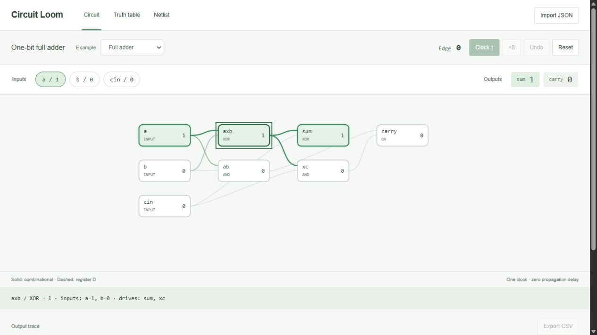

# Circuit Loom

An interactive digital-logic bench with editable netlists, live signal values, simultaneous register sampling, undoable clock edges, truth tables, and waveform/CSV traces.



## Run

Python 3.10+; no dependencies or build step:

```sh
python run.py
```

Open http://127.0.0.1:8000. Computation stays in the browser. The server exposes only the four static app assets on loopback, checks Host headers, and applies a restrictive content policy.

## Workspace

The Circuit view places live input switches and output bits above the dependency graph, with clock controls in the toolbar and the waveform below. Green wires carry a high signal; selecting a node highlights it and shows its connections. Truth table and Netlist have separate views. Input switches retain keyboard focus when toggled.

Selecting a node emphasizes its direct incoming and outgoing wires. Click the graph background or press Escape from a node to clear the emphasis. Nodes whose evaluated bit changed flash briefly after an input or clock update; this marks the completed state change rather than modeling propagation delay, and respects reduced-motion preferences.

## Try the bench

- **Full adder:** toggle `a`, `b`, and `cin`; compare sum/carry with the complete eight-row truth table.
- **Shift register:** set `data=1`, step once, set it back to zero, and watch the bit move one register per edge. It never ripples through all registers on a single clock.
- **Enabled counter:** set `enable=1`, step eight times to wrap, then disable it to hold the state.
- Select a graph node to inspect its current value, drivers, consumers, and next sampled D value. Wires are a logical dependency diagram, not a physical gate schematic.
- Step one or eight edges; undo restores the previous register state and the inputs sampled at that edge. Reset restores declared register initial values and zeroes inputs.
- The waveform shows outputs after the last 32 edges. CSV exports all sampled edges, up to 256, including input values, before/after register states, and outputs. At the cap, export, undo, or reset before continuing.
- Truth tables enumerate all inputs while holding the **current** register state fixed. Separate `next:` columns show what one edge would sample; generating a table does not advance time.
- Edit or import JSON netlists, then validate/apply. Invalid edits leave the active circuit intact. Saving a netlist exports the active validated circuit, not unapplied editor text.

## Netlist format

```json
{
  "name": "Toggle flip-flop",
  "nodes": [
    {"id": "q", "type": "dff", "inputs": ["inverse"], "initial": 0},
    {"id": "inverse", "type": "not", "inputs": ["q"]}
  ],
  "outputs": ["q"]
}
```

Supported node types:

| Type | Fields beyond `id` and `type` | Meaning |
| --- | --- | --- |
| `input` | none | Externally toggled bit |
| `const` | `value`: 0 or 1 | Constant signal |
| `not` | `inputs`: one ID | Boolean inversion |
| `and`, `or`, `xor` | `inputs`: two IDs | Binary Boolean gate |
| `mux` | `inputs`: [select, when0, when1] | One-bit multiplexer |
| `dff` | `inputs`: one ID; `initial`: 0 or 1 | Clocked state |

Limits: 64 nodes, eight external inputs, sixteen registers, eight outputs, 30 KB imported files, and 256 sampled edges. IDs start with an ASCII letter and contain letters, digits, or underscores, up to 24 characters. Unused nodes are still validated. Declaration order is immaterial.

## Evaluation semantics

The compiler validates fields, fan-in arity, references, limits, and unique IDs. A depth-first topological traversal treats register outputs as roots, breaking sequential feedback while rejecting combinational cycles with a concrete cycle path.

Evaluation propagates numeric 0/1 values in topological order. A clock operation first evaluates the entire old-state circuit, snapshots every D input, replaces all registers together, and then reevaluates combinational outputs. Register sampling follows the [rising-edge D-register model](https://cburch.com/logisim/docs/2.3.0/libs/mem/register.html); there is one abstract shared clock, advanced explicitly by the UI.

This is a zero-delay two-state logic model. It does not simulate analog voltages, propagation hazards, setup/hold times, metastability, tri-state buses, X/Z states, asynchronous reset, gated clocks, multiple clock domains, or HDL synthesis. Netlists and traces are portable JSON/CSV for this tool, not Verilog or VHDL.

## Verification

Node.js 22+ is required only for development checks:

```sh
npm test
npm run check
python -m unittest discover -s tests -p "test_*.py"
```

11 JavaScript tests cover exhaustive full-adder arithmetic, simultaneous shifting, 64 enabled counter transitions and holds, register initialization, cycle witnesses, every gate and mux input order, declaration-order independence, state-conditioned truth tables, malformed netlists/vectors, 120 generated circuits against an independent recursive Boolean evaluator, immutability, and trace serialization. One Python server test checks route boundaries, HEAD, Host validation, and content policy. CI runs Linux and Windows checks.

Browser validation exercises adder toggles, one-stage shifting, undo, counter wraparound, node inspection, and rejected cyclic edits. All nine downloaded CSV counter transitions were independently checked against modulo-eight arithmetic, including both before and after register states.
